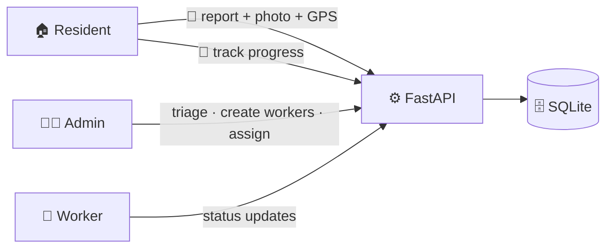
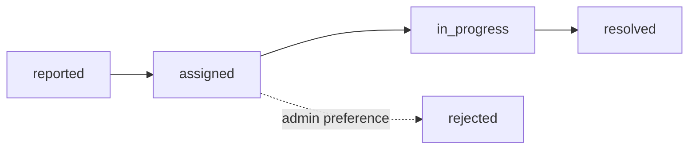

<div align="center">

# 🏛️ CivicFix


**Spot it. Snap it. Fix it.** — a civic issue reporting and resolution platform.

Residents report civic problems with a photo and GPS location, admins triage and assign municipal workers, and workers keep the status live. No call centers, no paper registers.


[Features](#-features) · [What's new](#-whats-new) · [How it works](#-how-it-works) · [Quickstart](#-quickstart) · [API](#-api-overview) · [Deployment](#-deployment) · [Team](#-team)

</div>

---

## 📌 About

CivicFix closes the loop between citizens and municipal workers — from *the pothole on my street* to *resolved*, with every step visible.

- A resident films the problem and attaches a photo, GPS coordinates, and an optional landmark
- The backend scores it from 0–100 with an explainable priority heuristic
- An admin triages the queue by priority and age, creates worker accounts and assigns them
- The assigned worker updates the status at every stage, and the resident watches it happen

## ✨ Features

| | Feature | Details |
|---|---|---|
| 📸 | **Photo-first reports** | Required JPEG / PNG / WebP photo up to 8 MB, stored and served by the API |
| 📍 | **Location capture** | GPS latitude/longitude plus an optional address or landmark |
| 🧠 | **Priority scoring** | Explainable keyword heuristic — category baselines, description keywords, sensitive place terms |
| 👤 | **Three roles** | `user`, `worker`, `admin` — enforced across every route |
| 🕒 | **Status history** | Every transition recorded with actor + note: `reported → assigned → in_progress → resolved` |
| 📊 | **Admin dashboard** | Queue sorted by risk and age, worker management, aggregate stats |
| 🛠 | **Worker workspace** | Assigned issue list and progress updates from the field |
| 🤖 | **AI photo verification (repo highlight)** | `Backend/ai_detector.py` — zero-shot CLIP (INT8 ONNX) runs inside the upload flow: reads the photo, cross-checks it against the report title and stores `{best, confidence, matches_title, suggested_category}` as `ai_analysis`. Model files are optional — without them the check is silently skipped and reporting is unaffected |
| 🏷 | **Manual category with AI helper** | The citizen always picks the category; AI never overrides it. One click on 🤖 Ask AI asks the configured Gemini model (`Backend/ai_categorizer.py`, via `POST /api/issues/category-suggest`) to suggest a category from title + description (strict JSON schema, confidence bound to 0–1). Failure, empty key, or disabled flag → no suggestion, never blocks a report. Set `CIVICFIX_GEMINI_API_KEY` to enable |
| 🔐 | **OTP password reset + email verification** | `Backend/mail.py` + `/api/auth/forgot-password` + `/api/auth/reset-password` + `/api/auth/verify-request` + `/api/auth/verify-confirm` — 6-digit codes hashed with a per-request salt, 10-minute expiry, 5-attempt limit, 60-second resend cooldown, one active code per email per purpose, constant-time verification, burned codes delete themselves. Signup auto-emails a verification code; the dashboard shows a verify banner on unverified accounts. SMTP is env-configured (Brevo/Gmail); without SMTP the endpoints fall back to dev mode and return the code for local testing |
| 🌓 | **Dark & light mode** | CSS-variable theme system with a topbar toggle — preference persists in localStorage, defaults to dark, no flash on reload (an inline bootstrap script applies the stored theme before first paint) |

## 🆕 What's new

Latest drop, all three live in the app right now:

- 🌓 **Dark & light mode** — one click in the topbar, saved across reloads, dark by default
- 🔐 **OTP email verification + password reset** — signup auto-emails a 6-digit code, forgot/reset flows built into the login page (SMTP env-configured)
- 🏷 **Manual category with AI helper** — the citizen always picks the category; 🤖 Ask AI only suggests, never overrides

## 🔀 How it works





The risk score on the backend (`by risk, then age`) is an explainable heuristic — not a calibrated probability and not a trained model. The frontend shows the returned `risk_percentage`:

| Range | Label |
|---|---|
| 0–39 | 🟢 Low |
| 40–69 | 🟡 Medium |
| 70–100 | 🔴 High |

<!-- 📸 Screenshots of the live app go here after deployment -->

## 🚀 Quickstart

**Prerequisites:** Python 3.12+, Node 20+ (or 22), npm

Copy-Item commands are listed in PowerShell. Any terminal would run the same commands in a shell version.

### 1. Start the backend

```powershell
cd Backend
python -m venv .venv
.venv\Scripts\Activate.ps1
python -m pip install -r requirements.txt
Copy-Item .env.example .env
```

Edit `Backend/.env` and set `CIVICFIX_SECRET_KEY` to a long, random string. To bootstrap the first administrator on first startup, additionally set `CIVICFIX_ADMIN_EMAIL` and `CIVICFIX_ADMIN_PASSWORD`.

```powershell
python -m uvicorn main:app --reload
```

- API → `http://localhost:8000`
- Interactive docs → `http://localhost:8000/docs`
- Database file → `database/civicfix.db` at the repo root (auto-created at startup)
- Uploads → `uploads/` at the repo root

### 2. Start the frontend (second terminal)

```powershell
cd frontend
Copy-Item .env.example .env.local
npm install
npm run dev
```

Open `http://localhost:3000`. The `NEXT_PUBLIC_API_BASE` in `.env.local` defaults to `http://localhost:8000`.

<details>
<summary><b>One-click launcher (Windows)</b></summary>

`start_servers.bat` starts the API (`http://localhost:8000`) and web (http://localhost:3000) in two command windows from the repository checkout.
</details>

## 🔐 Environment variables

| Variable | Where | Purpose |
|---|---|---|
| `CIVICFIX_SECRET_KEY` | Backend `.env` | JWT signing key — replace with a long, random secret |
| `CIVICFIX_TOKEN_MINUTES` | Backend `.env` | Token lifetime (default `1440`) |
| `CIVICFIX_CORS_ORIGINS` | Backend `.env` | Comma-separated allowed frontend origins |
| `CIVICFIX_ADMIN_EMAIL` | Backend `.env` | Optional — creates the first admin on startup |
| `CIVICFIX_ADMIN_PASSWORD` | Backend `.env` | Optional — password for the bootstrap admin |
| `CIVICFIX_ADMIN_NAME` | Backend `.env` | Optional — display name of the bootstrap admin |
| `CIVICFIX_GEMINI_API_KEY` | Backend `.env` | Optional — Google AI Studio key enabling the AI category suggestion helper |
| `CIVICFIX_GEMINI_MODEL` | Backend `.env` | Optional — defaults to `gemini-2.0-flash` |
| `CIVICFIX_SMTP_HOST` / `_PORT` / `_USER` / `_PASSWORD` / `_FROM` | Backend `.env` | Optional — SMTP for OTP email delivery; unset = dev mode returns the code |
| `NEXT_PUBLIC_API_BASE` | Frontend `.env.local` | Backend URL with no trailing slash |

Real secrets are to be kept out of Git, never commit `.env`, `.env.local`, SQLite database files, or uploaded photo content.

## 🌐 API overview

| Method | Route | Purpose |
|---|---|---|
| `POST` | `/api/auth/register` | Register a resident account |
| `POST` | `/api/auth/login` | Log in and receive a token |
| `GET` | `/api/auth/me` | Current signed-in account |
| `POST` | `/api/auth/forgot-password` | Email a 6-digit OTP (dev mode returns the code when SMTP is unset) |
| `POST` | `/api/auth/reset-password` | Verify the OTP and set a new password |
| `POST` | `/api/auth/verify-request` | Email a 6-digit OTP to verify the account address |
| `POST` | `/api/auth/verify-confirm` | Verify the emailed code and mark the account verified |
| `GET` | `/api/issues` | Browse reports (public) |
| `POST` | `/api/issues` | Submit a report — authenticated multipart form + required photo. Optional `lat`,`lng`,`address` |
| `GET` | `/api/issues/{id}` | One report (public) |
| `PATCH` | `/api/issues/{id}` | Edit report (reporter or admin) |
| `GET` | `/api/issues/{id}/updates` | Status history |
| `POST` | `/api/issues/{id}/status` | Worker/admin status update |
| `GET` | `/api/worker/assignments` | The signed-in worker's assigned reports |
| `GET · POST` | `/api/admin/workers` | List or create worker accounts |
| `GET` | `/api/admin/issues` | All reports ordered by risk and age |
| `POST` | `/api/admin/issues/{id}/assign` | Assign a worker |
| `GET` | `/api/admin/stats` | Agenda-level counts |
| `GET` | `/api/health` | Liveness |

Categories: `roads`, `water`, `electricity`, `cleanliness`, `other`

## 🧪 Tests

```powershell
cd Backend
python -m unittest discover -s tests -v
```

## 📦 Deployment

This repo ships a **Render Blueprint** (`render.yaml`) so both services deploy from one apply.

1. With the repo authorizing Render access, open **Render Dashboard → New → Blueprint → this repository**
2. This wizard creates two services using the file's commands:
   - `civicfix-api` — FastAPI on Python 3.12 (`pip install -r requirements.txt`, uvicorn)
   - `civicfix-web` — Next.js on Node 22 (`npm install && npm run build`, `next start`)
3. Set the `sync: false` variables when prompted — the backend's `CIVICFIX_CORS_ORIGINS` frontend URL, the `NEXT_PUBLIC_API_BASE` backend URL, and the bootstrap admin credentials
4. Apply — both services build and deploy, and every push to `main` redeploys them automatically

The deployed instance is live:

- **App:** [civicfix-web.onrender.com](https://civicfix-web.onrender.com)
- **API docs:** [civicfix-bl4k.onrender.com/docs](https://civicfix-bl4k.onrender.com/docs)

Free-tier instances sleep after inactivity — the first open takes about a minute to wake up. The SQLite database and uploaded photos reset on every restart or redeploy — fine for demos, not production persistence.

## 🧗 Challenges we ran into

Real problems hit while building and deploying this — and what they taught.

**CORS misbehaving between two live origins.** The API worked perfectly in curl but the deployed frontend still couldn't call it — preflights returned `400` with no `Access-Control-Allow-Origin` header. The allow-list still held the `localhost` default, and CORS failures are invisible outside a browser. Fixed by driving `CIVICFIX_CORS_ORIGINS` from environment configuration and keeping localhost in the list for local development. *Lesson: treat deploy endpoints as configuration, never hardcode them.*

**Render free tier wakes up slowly.** Services sleep after idle time — the first visitor waits about a minute on the wake-up screen. Documented instead of hidden; the trade-off is documented behavior, not a surprise.

**Free instances have no persistent disk.** SQLite databases and uploaded photos reset on every restart or redeploy. The platform is built so this only loses demo data, not user trust — a production rollout would swap in managed storage or Postgres.

**Globally unique service URLs.** `civicfix-api` was already reserved, so the API went live as `civicfix-bl4k.onrender.com` — and the frontend's `NEXT_PUBLIC_API_BASE` must point at the real URL, not the intended one. *Lesson: the name you choose is not the URL you get.*

**Location permission is not guaranteed.** The report flow depends on GPS, but browsers can deny geolocation. The form detects failure and blocks submission with a clear message rather than creating an issue that crews can't find. *Lesson: design for permission denial, not just success.*

**Schema changes after data existed.** The `ai_analysis` column was added after tables were already created, so the backend runs a live migration on startup (`PRAGMA table_info` check + `ALTER TABLE`) — older local databases keep working without a manual upgrade step.

## 👥 Team

| Member | Role | GitHub |
|--------|------|--------|
|  **Nalinikanta Pani** | Project Lead · Backend & Integration | [@paninalinikanta352-collab](https://github.com/paninalinikanta352-collab) |
|  **Vanshita** | Frontend | [@Vanshita-2007](https://github.com/Vanshita-2007) |
|  **Omkodilkar** | AI Developer | [@omkodilkar](https://github.com/omkodilkar) |

---

<div align="center">
<sub>Backend route details → <a href="Backend/README.md">Backend/README.md</a> · Team & roles → <a href="TEAM.md">TEAM.md</a></sub>
</div>
